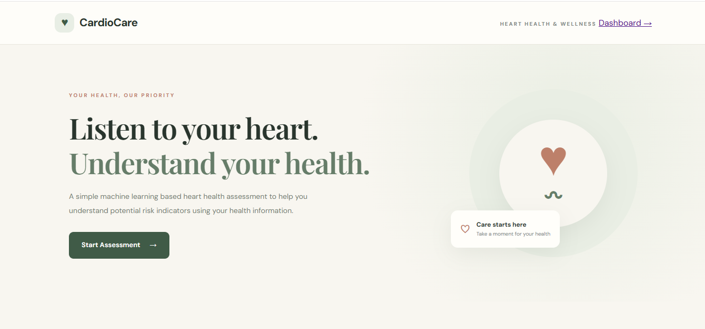
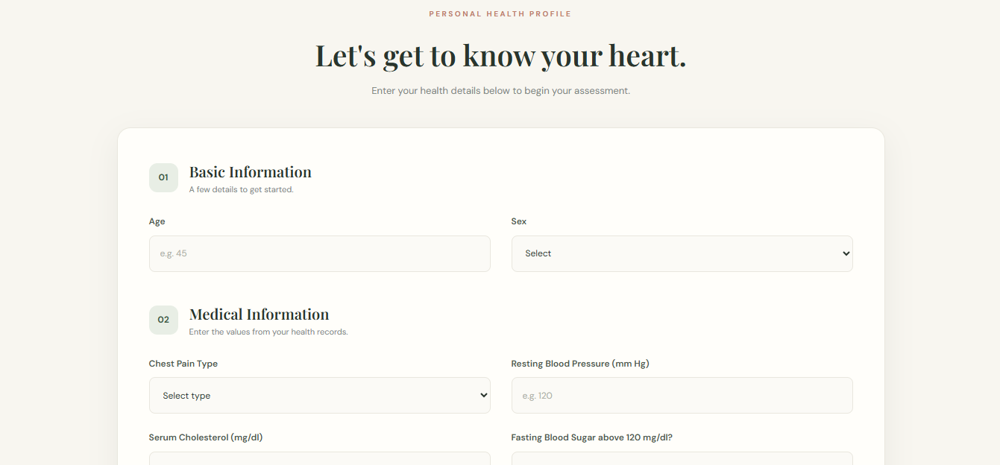
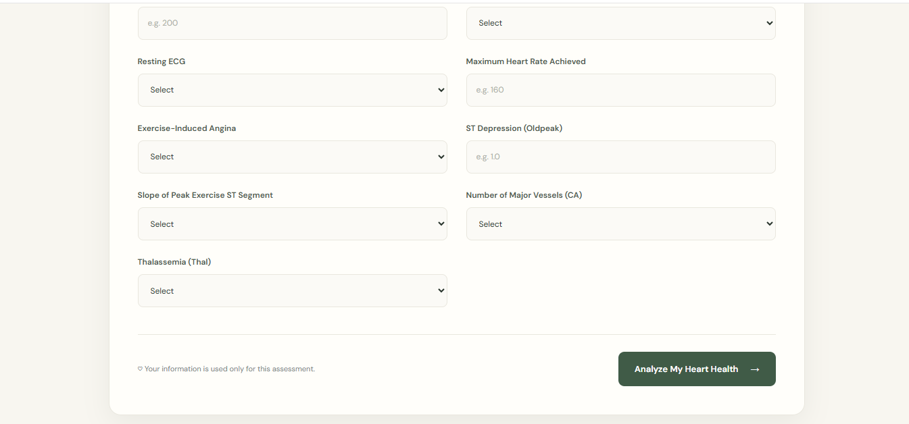
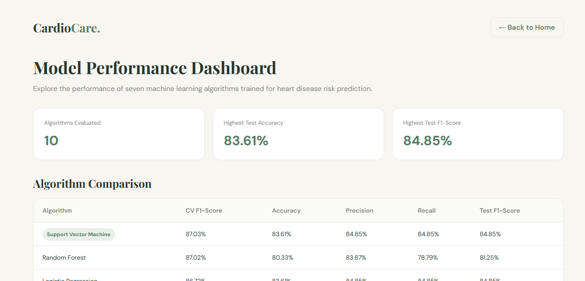
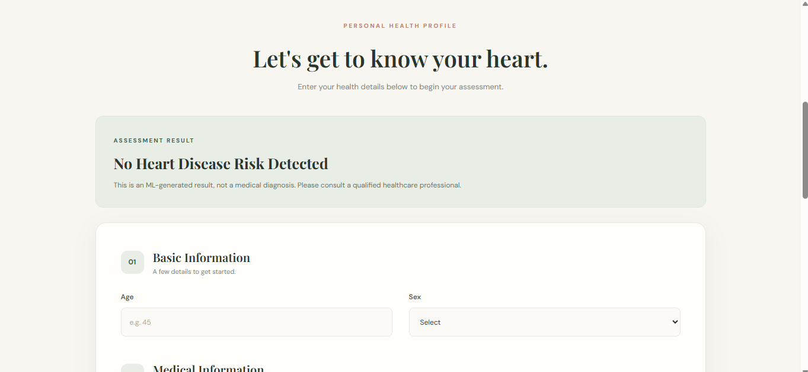

# CardioCare – Heart Disease Prediction System

CardioCare is a Machine Learning based web application designed to predict the likelihood of heart disease using patient health parameters.

The project combines multiple Machine Learning algorithms, model optimization, experiment tracking, and an interactive Flask dashboard to demonstrate an end-to-end Machine Learning workflow.

> **Disclaimer:** CardioCare is an academic project and is not intended to replace professional medical advice, diagnosis, or treatment.

## Key Features

- Heart disease prediction using Machine Learning.
- Multiple ML algorithms for model comparison.
- Hyperparameter tuning and model optimization.
- Data preprocessing and feature transformation.
- MLflow experiment tracking.
- Interactive Flask-based web application.
- Dashboard for viewing model performance.
- Automated testing using Pytest.
- Docker support for containerization.
- GitHub Actions workflow for Continuous Integration.

## Machine Learning Workflow

1. Data collection
2. Exploratory Data Analysis (EDA)
3. Data preprocessing
4. Feature transformation
5. Model training
6. Model comparison
7. Hyperparameter optimization
8. Model evaluation
9. Prediction through Flask application

## Technology Stack

| Category | Technologies |
|---|---|
| Programming | Python |
| Data Analysis | Pandas, NumPy |
| Machine Learning | Scikit-learn, XGBoost |
| Visualization | Matplotlib, Seaborn |
| Experiment Tracking | MLflow |
| Web Framework | Flask |
| Model Persistence | Joblib |
| Testing | Pytest |
| Containerization | Docker |
| Version Control | Git, GitHub |

## Project Structure

```text
CardioCare/
│
├── data/
│   ├── raw/
│   └── processed/
│
├── docs/
├── models/
├── notebooks/
├── reports/
│
├── src/
│   ├── components/
│   ├── pipelines/
│   └── utils/
│
├── static/
│   ├── css/
│   ├── js/
│   └── images/
│
├── templates/
├── tests/
│
├── mlruns/
├── app.py
├── requirements.txt
├── Dockerfile
├── .dockerignore
└── README.md
```

## Installation and Setup

### 1. Clone the repository

```bash
git clone https://github.com/gauravkuwar80/cardiocare.git
cd cardiocare
```

### 2. Create a virtual environment

```bash
python -m venv .venv
```

### 3. Activate the environment

**Windows PowerShell:**

```powershell
.venv\Scripts\Activate
```

### 4. Install dependencies

```bash
pip install -r requirements.txt
```

### 5. Run the application

```bash
python app.py
```

Open your browser and visit:

- Main Application: http://localhost:5000
- Dashboard: http://localhost:5000/dashboard

## Docker Setup

Build the Docker image:

```bash
docker build -t cardiocare:1.0 .
```

Run the container:

```bash
docker run -d --name cardiocare-app -p 5000:5000 cardiocare:1.0
```

Open http://localhost:5000 in your browser.

## Running Tests

Execute automated tests using:

```bash
python -m pytest tests/ -v
```
## Application Screenshots

### Home Page




### Dashboard


### Prediction Result


## Experiment Tracking

MLflow is used to track Machine Learning experiments, including model parameters, evaluation metrics, and experiment runs.

## Future Improvements

- Improve model performance and validation.
- Expand automated test coverage.
- Integrate a cloud-based DVC remote.
- Enhance model monitoring and experiment management.
- Improve the user interface and reporting features.

## Author

**Gaurav Kuwar**

B.Tech – Computer Science and Engineering

## Project Information

**Project Name:** CardioCare – Heart Disease Prediction System

**Project Type:** Academic Minor Project

**Domain:** Machine Learning and Web Development

---

If you find this project interesting, consider giving the repository a star!